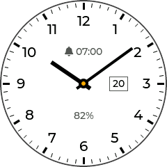
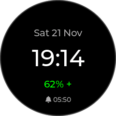
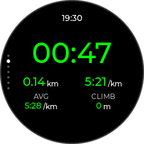
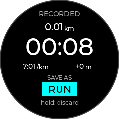
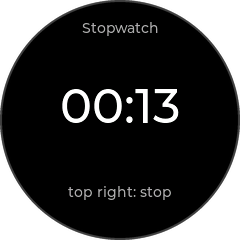
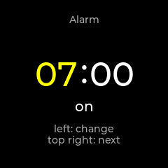

# UNA Watch on Zephyr

An own firmware for the [UNA Watch](https://unawatch.com/), built on
[Zephyr](https://zephyrproject.org/) in place of the stock kernel:

<p>




</p>
<p>


</p>
<p>




</p>
<p>




</p>

Screenshots from the firmware's simulator, taken with `una-z -s
shot --round`, which cuts the square image to the watch's round screen; the
watch draws the same screens.

- `zephyr/` — west workspace; only `zephyr/una/` is tracked: the manifest, the
  `una_watch` board, drivers and the app
- `scripts/` — `una-z` (drive the watch or the simulator), `una-pack` and
  `una-backup` (first install), on `PATH` inside the dev shell
- `docs/` — the plan ([docs/zephyr-plan.md](docs/zephyr-plan.md)), datasheets
  and hardware notes ([docs/README.md](docs/README.md))
- `refs/` — upstream clones, not tracked: `una-kernel-public` (the stock
  firmware's source, the reference for every driver here, and its packer,
  which `una-pack` uses) and `una-hardware` (schematics)
- `build/` — build output, not tracked

## Environment

`direnv allow` once; the flake provides Arm GNU Toolchain 14.3.rel1, CMake,
Ninja, Python with what west and the Zephyr build need, SDL2 for the
simulator, smpmgr for firmware upload, plus openocd, probe-rs, tio and clangd.

## What it does

- Five watch faces: a digital one and four analogue dials, white or black
  (below). Each shows the date, the battery and the alarm time.
- One ring of pages, no menu: face, recorder, messages, compass, stopwatch, countdown
  timer, one daily alarm, settings (backlight time, wrist light, sound, vibration,
  Bluetooth, power off) and systems. Timer and alarm ring with the buzzer and the vibration motor.
- One recorder for every activity: it keeps time, distance, pace and climb
  and writes a FIT file as it goes; whether it was a walk, run, ride or hike
  is a label on the summary. The GPS receiver gets its first fix in about a
  minute outdoors; a whole track is still to be recorded.
- Bluetooth to an Android phone through Gadgetbridge: the phone sets the
  clock and its notifications are shown on the watch (below).
- System pages in the manner of an aircraft's: an overview of the subsystems
  on the power lines, and a page each for the electrical system (currents,
  charge, an hour's trend), the MCU, storage, the GPS receiver (satellites
  and their signal strengths), the radio and alerts.
- Battery gauge and charger status (the percentage is worked out from the
  gauge's charge estimate: its own figure stays at 100 for the first tenth
  of a discharge, see `charge()` in `src/power.c`), power-off, Stop mode whenever idle and off
  USB: about 0.85 mA idle, a week on a charge (measured at v0.1.0).
- Clock from the RTC with a stored UTC offset, set from the computer or by
  the phone.
- Log files on the eMMC with a telemetry line a minute.
- Firmware update over USB with automatic rollback; a simulator.
- The plan is [docs/zephyr-plan.md](docs/zephyr-plan.md).

## Hardware: what works and what is left

Every part of the watch, and how far this firmware drives it. The pins and
addresses are in `zephyr/una/boards/una/una_watch/una_watch.dts` and, for
what is not driven yet, in [docs/zephyr-plan.md](docs/zephyr-plan.md); the
stock firmware's source (`refs/una-kernel-public`) is the reference for
each of them.

| Part | State | What works | What is left |
|---|---|---|---|
| STM32U5A5 MCU | works | clocks, RTC, watchdog, Stop 2 when idle | idle draws about 1 mA, the stock firmware 0.07 to 0.08: see below |
| Display, Sharp LS012B7DD06A | works | own driver (`zephyr/una/drivers/display`), LVGL, backlight | |
| Buttons, four | works | press and hold, wake from Stop | |
| USB-C, high speed | works | shell and firmware update on two serial ports, at full speed (high speed deafens the radio); off on battery | the volume as a USB drive |
| eMMC, 4 GB | works | the stock user volume (exFAT): logs and recordings | |
| PMIC and charger, PCA9420 | works | charger state and limit read, power off (registers, in `src/power.c`) | |
| Fuel gauge, MAX17262 | works | percentage, voltage, current, charge | its model is the stock one and reads full too long: worked around in `charge()` |
| Buzzer | works | timer, alarm, calls | |
| Vibration motor, DRV2625 | works | nudges and ringing, open loop (`src/alert_hw.c`) | its calibrated closed-loop mode |
| GPS, Airoha AG3335M | works | own driver (`zephyr/una/drivers/gnss`): fix in about a minute, position, speed, satellites | assisted start (EPO), a whole track checked outdoors, the count of satellites heard is too low |
| Bluetooth, ST BlueNRG-2N | works | Zephyr's stack, the chip as a plain controller (needs ST's firmware 3.4.0 in it): one serial service for a paired phone, Gadgetbridge | |
| USB-C controller, STUSB4500 | not driven | charges at its defaults | reading what the cable offers |
| Barometer, MS5837-02BA | works | on while recording, read once a second (`src/baro_hw.c`): climb, and altitude in the file | floors; what it costs in current is not measured |
| Accelerometer and gyro, BMI270 | works, not yet tried on a wrist | own driver (`zephyr/una/drivers/sensor/bmi270`, made of Zephyr's): the chip's step counter and activity, read once a minute; a turn of the wrist lights the screen (`src/motion_hw.c`) | steps and wrist turn checked on a wrist; steps kept over a restart, shown on a page and stored per day; cadence; what it costs in current |
| Magnetometer, BMM350 | works, not yet calibrated or checked against north | own driver (`zephyr/una/drivers/sensor/bmm350`, made of Zephyr's), on while the compass page is shown (`src/compass_hw.c`): heading with the tilt taken out by the accelerometer, calibration by turning the watch | calibration and heading tried on the watch; true north (declination); its interrupt, PC2, is not used |
| Heart rate, PixArt PAH8316 | works at rest; wrong on a first run (40 to 90 a minute at a run), not yet tried against a strap | own driver (`zephyr/una/drivers/sensor/pah8316`), written from what PixArt's library was seen to do on the bus (`docs/sensors/pah8316-registers.md`) and with nothing of it; a pulse of our own making (`src/hr_alg.c`), within 2 a minute of PixArt's on average at rest; on while its page is shown, while recording (into the file) and while an app listens to the Bluetooth heart rate service | the pulse while walking and running, against a chest strap; what it costs in current; a pulse through the day; SpO2 and HRV, which the chip has settings for |

The USB-C controller has its supply with the watch and is left as it starts.

What is left besides the parts, roughly in the order it would be missed:

- **Idle current.** About 1 mA with the CPU asleep 99.9 % of the time, so
  something draws while in Stop: a week on a charge, where the stock
  firmware's idle figure would allow many times that. Suspects and a way to
  measure them are in the plan.
- **Pairing.** Any phone in range can connect to the watch (see Phone).
- **Daily health**: the steps are counted but only the shell and the log
  show them (`motion`); a page for them, a file per day, and heart rate.
- **More from the phone**: music control, weather, calendar, answering or
  rejecting a call. Gadgetbridge sends them already; `src/phone.c` ignores
  what it does not know.
- **Long messages** are cut off at six lines; they should scroll.
- **Firmware update over Bluetooth.** Over USB only today.
- **Assisted GPS data**, for a first fix in seconds.
- **Apps loaded from the eMMC** (Zephyr's LLEXT), far off.

Help is welcome with any of it. The simulator runs everything but the
hardware itself, so the pages and the phone protocol can be worked on
without a watch.

The version is in `zephyr/una/app/VERSION` and shown on the MCU system page.

The stock bootloader stays in place and starts MCUboot at 0x08060000, which
starts the app:

| Flash | Contents |
|---|---|
| 0x08000000, 384 KB | UNA bootloader and shared C library; never written |
| 0x08060000, 128 KB | MCUboot |
| 0x08080000, 1536 KB | slot 0, the running image |
| 0x08200000, 1536 KB | slot 1, where an upload lands |
| 0x08380000, 512 KB | settings (UTC offset, alarm, backlight time, ...) |

```sh
west init -l zephyr/una && (cd zephyr && west update --narrow -o=--depth=1)   # once
west build -b una_watch --sysbuild -d build/zephyr zephyr/una/app
```

## Day to day, cable in, no buttons

```sh
west build -d build/zephyr && una-z flash   # ~30 s: upload, test boot, confirm
una-z sh kernel uptime                      # any shell command
una-z shot                                  # screenshot -> build/shot.png
una-z shot --round face.png                 # cut to the round screen, for showing
una-z press 3                               # press SW3 (SW1-SW4, see the board dts)
una-z press 4 1000                          # hold SW4 for a second
una-z log 10                                # watch log messages for 10 s
una-z logs                                  # copy the log files off the eMMC -> logs/
una-z runs                                  # copy the recorded activities -> runs/
una-z time                                  # set the watch's clock from this computer
una-z reset                                 # reboot through mcumgr
```

`una-z flash` boots the new image once as a test and confirms it when its shell
answers. An image that crashes, hangs (8 s watchdog) or is never confirmed is
swapped back for the previous one at the next reset.

The watch is two USB serial ports, `2fe3:0004` "UNA Watch Zephyr": interface 0
is the shell, interface 2 is mcumgr. `/dev/una-watch` does not point at either.

If `una-z flash` is interrupted before it has confirmed, the new image keeps
running unconfirmed and the next upload fails. `una-z sh mcuboot` shows that
state (`confirmed: 0`); `una-z sh mcuboot confirm` keeps the image, a reset
puts the previous one back.

## Simulator

The same app builds as a Linux program (Zephyr's `native_sim`): the UI, the
shell, settings, the clock, alarms and timers run as on the watch, with the
screen in SDL. What is hardware on the watch (battery, buzzer, motor) is
stood in for by `src/sim.c` and set or read with the `sim` shell command;
the GPS receiver is Zephyr's emulated one and the user volume is the
directory `build/sim/user`. The phone is stood in for too: `sim phone on`
connects one and `sim phone <hex>` has it send a line. Power and USB are
not in it.

```sh
west build -b native_sim/native/64 -d build/sim zephyr/una/app   # once; then west build -d build/sim
una-z sim                    # start it (again), no window; sets its clock
una-z sim --window           # the same with the screen in a window
una-z -s shot                # as on the watch -> build/sim-shot.png
una-z -s press 2
una-z -s sh sim battery 15 0 # 15 %, no USB power
una-z -s sh sim state        # buzzer, motor, power-off asked for
una-z -s sh sim gps 59.33 18.07 20   # a fix: latitude, longitude, altitude
una-z -s sh sim move 11 45 5 # from there at 11 km/h heading 45, climbing 5 m/min
una-z -s sh sim baro off     # no barometer answers (it follows the altitude otherwise)
una-z -s sh sim steps 120    # so many more steps are walked
una-z -s sh sim wrist        # the wrist is turned: the screen lights
una-z -s sh sim compass 247  # twelve o'clock points west-southwest
una-z -s runs                # the recorded FIT files -> runs/
una-z sim stop
```

`prj.conf` is what both builds share; `boards/una_watch.conf` and
`boards/native_sim_native_64.conf` are added for each. Settings are kept in
`build/sim/flash.bin`.

## Buttons and screens

The pages lie in a ring and the buttons mean the same on all of them:

| Button | Stock name | Does, everywhere |
|---|---|---|
| SW1, top left | UP | previous of what is beside this: page, row, value |
| SW3, bottom left | DOWN | next |
| SW2, top right (power) | SELECT | what the page does, or go in; held: go in to change it |
| SW4, bottom right | BACK | out one level, then to the face; held: the face |

DOWN from the face goes through the ring in this order, UP the other way:

| Page | SELECT | SELECT held |
|---|---|---|
| Face | | go in: choose the face |
| Record | start, pause, resume | finish |
| Messages | go in: the ones before the latest | |
| Pulse | | |
| Compass | start, stop the calibration | |
| Stopwatch | start, stop | reset |
| Timer | start, stop | go in: set the minutes |
| Alarm | on, off | go in: set hour, then minute |
| Settings | go in: the list; then change the row | on "power off": power off |
| Systems | go in: a page per subsystem | the same |

A short press of SELECT on the face does nothing, so that a slip does not
change it. Holding UP or DOWN on a page of the ring does nothing yet and is
kept for later. Holding SELECT is not power-off, which is a row in the
settings; held for some 20 s it is the power chip's own reset (When the app does not come up).
Holding BACK also silences what rings.

Inside, UP and DOWN change the value or move to the next row or page, and
what can be changed is cyan. There are no questions to confirm: what would
need one is asked for by holding instead. A press is acted on at release;
"held" is 0.7 s. Timer and alarm ring with the buzzer and the motor (`alert
ring` in the shell does the same) until any button is pressed. `una-z sh ui`
shows the current page, `una-z sh ui page timer` goes to one.

The system pages use one set of colours: white for names and units, green
for a live value that is normal and for a line that carries current, amber
and red for what needs attention, cyan for what can be set, grey for what is
off or not known. They are drawn in `src/systems.c` with the helpers of
`src/draw.c`.

## Recording

SELECT on the Record page starts at once; the clock runs while the receiver
looks for its first fix. A short press only ever pauses and resumes, so a
recording is not ended or lost by a slip; holding SELECT finishes it and
shows the summary with a guess of what it was (by the average speed), which
UP and DOWN change. The other pages stay within reach while recording, and
BACK leads to the recording instead of the face.

A recording made by mistake is discarded from the summary by holding SELECT
for three seconds, while a red bar fills; letting go before it is full keeps
the recording. Discarded files are moved to `/Activity/discarded`, not
removed.

A recording that is forgotten finishes itself: after ten minutes with
neither a fix nor thirty steps, for the receiver empties the battery in
some eight hours (26 to 30 mA while recording, against 0.55 mA idle,
measured at v0.5.0). Some 9 mA of that is the SoC, kept out of Stop mode
for the receiver's UART (`una-z sh power awake SECONDS` does the same
without the receiver, to measure it).

The file is `/Activity/YYYYMM/activity_<start>.fit` on the user volume:
a record a second (position, distance, speed, altitude), a lap a kilometre
with a nudge of the motor, and the session. It is written as it is recorded
(`recording.fit`, synced every 10 s) and one that power was lost in is
finished at the next start. `una-z runs` copies the files; they open in
anything that reads FIT. The writer is `src/fit.c`, the recorder
`src/record.c`; `una-z sh record` shows its state.

The altitude in the file is the barometer's, set right by the receiver's:
by the mean of what the two differ by over up to ten minutes of fixes,
leaving out the receiver's first minute and fixes with an HDOP above 2.5,
when its height is tens of metres off. Until there is such a fix the
records have no altitude.

While it is recorded, what the heart-rate sensor and the accelerometer
gave is kept too (`/Log/PPG/raw-<start>.txt`, about 1 MB an hour, `una-z
ppg` copies it), to work on the pulse with `scripts/hr-replay`:
`CONFIG_UNA_HR_RAW_RECORDED`, until the pulse of a run is right.

The receiver (Airoha AG3335M on LPUART1, driver in
`zephyr/una/drivers/gnss/`) is on only while something is recorded, or
while the GNSS system page has turned it on with SELECT, to look at it
without recording. While it is on, a line goes to the log every ten
seconds (fix, satellites used and heard, the six best signal strengths,
time to the first fix), so that what happened outdoors can be read from
`una-z logs` afterwards; `una-z sh gnss` shows the same now, and `una-z sh
gnss on` turns it on from the shell.

## Phone

The watch talks to [Gadgetbridge](https://gadgetbridge.org) on Android, which
takes it for a Bangle.js: a serial line (the Nordic UART service) with a
line of text per message. The phone sets the clock when it connects, and
what it is notified of is shown on the watch with a nudge: the app, the
title, the text and when it came. The Messages page keeps the last eight;
one dismissed on the phone goes from the watch as well. A call rings, and
"find my device" does too. The watch tells the phone its version and
battery.

To add the watch in Gadgetbridge, once: in its settings turn on "Discover
unsupported devices"; press +, and long-press "UNA Watch" in the list;
choose "Add test device" and then Bangle.js. Leave "Text as bitmaps" off in
the device's settings.

Bluetooth is Zephyr's own stack on the SoC, with the radio chip
(BlueNRG-2N) as a plain controller over SPI (`st,hci-spi-v2` with
`req-ll-only` in the board's devicetree). The chip does that properly only
from ST's firmware 3.4.0 on, which has to be loaded into it once: see the
section after the next. `src/bluetooth.c` starts the stack, keeps the watch
advertising, once a second, and offers the one service (the Nordic UART
service, after Zephyr's `CONFIG_BT_ZEPHYR_NUS`); `src/phone.c` reads and
writes the lines. Fifteen seconds after the phone has opened the line the
watch asks it for a slow pace (100 to 200 ms, four in five skipped), which
is what the battery pays for all day. The watch goes by an address of its
own, not the chip's, so that the stock firmware's phone app does not take it
for its watch. Bluetooth is turned off in Settings, which holds the chip in
reset; `una-z sh radio` shows the state, as does the BLE system page, and
`una-z sh radio restart` starts the radio over. The log says what the stack
does, and at start which firmware the chip has.

### Pairing

The serial line is only for a phone that has paired. The first time a phone
reaches for it (in Gadgetbridge: connect) the watch shows six digits and
Android asks for them; typed in, the two are bonded and the link is
encrypted from then on, without asking again. Any button on the watch gives
the pairing up. A phone that has not got that far within a minute of
connecting is dropped.

It is LE Secure Connections with passkey entry and nothing weaker
(`CONFIG_BT_SMP_SC_PAIR_ONLY`), the keys made of the SoC's random number
generator. Up to four phones are remembered, in the settings in the SoC's
flash; a fifth takes the place of the oldest. "Hold: unpair" in Settings
forgets them all, as does `una-z sh radio forget`; `una-z sh radio` says how
many there are and whether the link is secure. When one side has forgotten
the other, forget on both ("Forget" under Bluetooth in Android's settings)
and pair again.

Three things are as they are for Android's sake. The watch does not ask for
security itself when a phone connects, but leaves it to the phone: a bonded
one encrypts at once, one that is not gets "insufficient authentication"
for the serial line and pairs. The watch offers no database hash
(`CONFIG_BT_GATT_CACHING=n`): with it, Android connects, encrypts and then
asks nothing more, and Gadgetbridge waits for ever to reconnect (tried both
ways with one phone and one bond: stuck with the hash, well without). The
price is that a paired phone is not told when the watch's services change.
So the serial service keeps its place whatever is added, and a phone finds
what was added after it paired only by pairing anew.
And the chip's report of a new connection is put right on its
way to the stack (`chip_recv()` in `src/bluetooth.c`): for a phone it does
not know it has the phone's address in the wrong field and all ones in the
right one, on which pairing fails.

### The radio chip's firmware

The chip comes with ST's firmware 3.2.0 (stack 2.1c), which connects as a
plain controller but passes no data. ST's 3.4.0 (stack 2.1f) does. It is in
the package STSW-BNRG2N, free of charge from ST after signing in:
<https://www.st.com/en/embedded-software/stsw-bnrg2n-v320.html> (choose
version 3.4.0; the page's name still says v320). ST's licence does not let
the image be passed on by itself, so it is not in this repository.

The chip's debug port is only on test points of the Bluetooth module, so the
watch loads the image itself, over SPI, through the updater the chip carries
in its first 8 KB of flash. That is a build of this firmware without
Bluetooth and with the image inside (`bnrg-update.conf`,
`src/bnrg_update.c`):

```sh
# 1. ST's image, to where the build looks for it
mkdir -p firmware/ble
unzip -j en.stsw-bnrg2n-v340.zip '*/fw_images/BlueNRG_2N_FW_V3_4_0.bin' -d firmware/ble
sha256sum firmware/ble/BlueNRG_2N_FW_V3_4_0.bin
# 119e982c37f24eadd9982a26752cee0f7908628cb0f124c23e8d656541d1bc26

# 2. the watch as the tool that loads it
west build -b una_watch --sysbuild -d build/bnrg zephyr/una/app -- -DEXTRA_CONF_FILE=bnrg-update.conf
una-z flash build/bnrg/app/zephyr/zephyr.signed.bin

# 3. what the chip has now
una-z sh -t 20 bnrg info
# firmware 3.2.0 (SPI), stack 2.1c, variant 0x000f
# in the updater, version 6 (started as 2)
# board settings: ff ff ff ff ff ff ff ff ff ff ff ff ff ff

# 4. optional: a copy of the chip's flash as it was (everything after the updater)
una-z sh -t 900 bnrg read 10042000 3e000 > chip-flash.txt

# 5. load it: half a minute
una-z sh -t 300 bnrg update
# writing 137672 bytes ... checking
# firmware 3.4.0 (SPI), stack 2.1f, variant 0x000f

# 6. the watch's own firmware again
west build -d build/zephyr && una-z flash
```

`bnrg update` asks the chip to restart as its updater, erases the flag that
marks the chip's image as whole, erases and writes the image sector by
sector (2 KB, in blocks of 64 bytes, from 0x10042000), has the chip sum
every sector and compares, and sets the flag again only when all sums are
right. Then it restarts the chip and prints the version it reports. A run
that is cut short leaves the chip without the flag, and so in its updater at
every start: run `bnrg update` again. It does nothing when the chip already
has 3.4.0 (`bnrg update again` writes it anyway), and wants the battery at
30 % or USB power. It is the procedure of ST's own updater for a host
processor (X-CUBE-BLE2, `IFRStack_Updater`).

The board's settings in the chip (crystal, low-speed clock, power supply)
are 14 bytes in the last sector of its flash (at 0x1007F900), which the
update leaves alone. The watch came with them blank, so the chip went by the
firmware's defaults, one of which does not fit the board: its switching
regulator (SMPS) on, for an inductor of 10 uH the board does not have.
`una-z sh bnrg smps off` sets the one byte that turns it off (`bnrg smps on`
puts back the blank): the sector is read whole, erased, written with the byte
changed and read again. Keep what `una-z sh bnrg read 1007f800 800` prints
first: the sector also holds data of the chip's own in its first 64 bytes.
The lines of `bnrg read` are an address and 32 bytes in
hex; written back in the same way they would restore the old image, though
nothing here does that yet.

The stock firmware finds stack 2.1f in the chip afterwards. The watch's
earlier firmware for the chip's own stack (`src/bluenrg.c` with ST's ACI
commands, as it was before) was seen to work on 3.4.0 too.

The link was often lost on the evening pairing was made ("disconnected:
0x08" in the log, a timeout; made again within seconds). That was the
watch's own USB at high speed, with the cable in: on the wrist the link
holds for hours, and USB is now kept at full speed, with which it holds on
the cable too; see `docs/zephyr-plan.md`.
`una-z sh radio` counts such losses, and `una-z sh radio pace MIN MAX LATENCY
TIMEOUT` (milliseconds, but for the latency) asks the phone for another
pace, for trying things.

Besides the serial line the watch has the standard battery and device
information services, open to any app.

Text from the phone is shown in fonts that have Latin-1 besides ASCII (made by
`scripts/una-fonts`); a character beyond that is a question mark.

## Watch faces

Holding SELECT on the face opens a chooser that shows each face; UP and DOWN
go through them and SELECT turns an analogue dial white or black. From the shell:
`una-z sh face 3 1` (face 0-4, white 0 or 1).

| Face | After | Battery shown as |
|---|---|---|
| Digital | | percentage, coloured by level |
| Bill | Max Bill's dials for Junghans: lines only | an arc under the centre |
| Rams | Braun's watches: numerals, batons, a yellow dot | a number; date in a window |
| Station | the railway station clock: heavy bars, block hands | a number |
| Tangente | Nomos: numerals and batons in turn, blue hands | a gauge where the original has its seconds |

The dials are drawn in `src/dial.c`, one function each, from a few helpers
(ticks, numerals, hands, arc, text). There is no second hand, so a dial is
redrawn once a minute. Colours are limited to the panel's four levels per
channel.

A screen is a `struct ui_screen` (`src/ui.h`): `enter` builds its widgets,
`update` refreshes them and says when it is next due, `key` gets the buttons.
The main thread sleeps between those, so an idle screen costs nothing.

## Telemetry

The watch writes its ordinary Zephyr log to the eMMC with the standard
file-system log backend: `/USER:/Log/Zephyr/log.NNNN`, 32 files of 1 MB, oldest
overwritten. `/USER:` is the stock firmware's user volume, so the same files
are under `Log/Zephyr/` when the stock firmware shows the drive over USB.

Once a minute the power thread logs one line:

```
power: tm 2026-11-21T19:07:48Z usb=1 soc=100 cap=228/228 rep=100 qh=522 mv=4401 ua=533 chg=6 stops=0 awake=6/1000 keys=0 backlight_ms=5000
```

`soc` is the percentage shown and `cap` the charge it is made from, in mAh
of what a full cell held; `rep` is the gauge's own percentage and `qh` its
plain coulomb counter (0.5 mAh a step), kept to check the first against.
`ua` is the mean battery current over the minute (negative = discharging; the
gauge is only good to a few mA), `stops` the number of Stop-mode entries,
`awake` the share of the minute the CPU was not idle, `keys` and
`backlight_ms` button presses and backlight time. After them come the radio
(`bt`, `rx`, `tx`, `ln`, `rssi`), the day's `steps` and the turns of the
`wrist` that lit the screen since boot. USB power changes are logged
as they happen.

Wear: a line is about 120 bytes, so about 170 KB a day, and each line costs
one sync of a few 4 KB blocks. Even at 1 MB of flash writes per sync that is
1.4 GB a day against roughly 12 TB of endurance (4 GB at 3000 cycles): decades.

## When the app does not come up

- **MCUboot recovery:** hold SW1 (top-left) through a reset. The screen keeps
  the UNA logo and the watch enumerates as "UNA Watch MCUboot". Then
  `smpmgr --port /dev/serial/by-id/usb-UNA_UNA_Watch_MCUboot_*-if00 image upload build/zephyr/app/zephyr/zephyr.signed.bin`
  followed by `... os reset`. This writes slot 0 directly.
- **Reset without a working app:** hold the power button (top-right) for about
  20 s; the PMIC power-cycles the watch. Keep holding for the UNA bootloader
  menu, release for a normal start.
- **MCUboot itself is broken:** install the `.ota` again through the UNA
  bootloader, as for the first install (below).

## First install, and going back to stock

The stock bootloader installs a kernel from an `.ota` file and does not care
whose it is. For Zephyr, MCUboot and the app are packed into one:

```sh
una-pack build/zephyr/mcuboot/zephyr/zephyr.bin \
         --at 0x20000 build/zephyr/app/zephyr/zephyr.signed.bin \
         -o build/zephyr/una-zephyr.ota
```

`firmware/zephyr-<version>/` (not tracked) keeps one that is known to work.
After this once, updates go over USB with `una-z flash`.

1. Charge the watch; the bootloader refuses to update on low battery.
2. Turn the watch off, then hold the power button for 4 seconds as it turns on,
   until the bootloader menu appears.
3. Connect USB. The watch shows "USB connected" and a drive appears.
4. First time only: run `una-backup` to save what is on that drive, including the
   factory-reset image (`.gld`) the watch shipped with.
5. Copy the `.ota` to the root of the drive. Leave the `.gld` alone unless you
   want to change what a factory reset restores.
6. Eject, unplug, and choose **Continue** in the bootloader menu. On bootloader
   0.1.4 this starts the old firmware once more; the update is installed at
   the next reset (hold power ~20 s). It then stays at 100 % until one more
   reset.

To go back to stock, do the same with UNA's own release
(`firmware/official-v1.7.0/UnaWatch-Kernel_1.7.0.ota` here; `firmware/` is
not tracked). The bootloader accepts any version, including older ones.

### What protects the way back

- An `.ota` holds only the kernel (flash from 0x08060000). The bootloader and the
  shared C library in the first 384 KB are not written by an update.
- The bootloader runs before the kernel and its menu is reached with the power
  button, so a kernel that does not boot can still be replaced.
- Not covered: a kernel that erases the bootloader itself, or a watch that
  cannot be powered off. The only fix then is the `.hex` (whole flash) over SWD,
  which needs a USB-C debug adapter that we do not have (see docs/README.md).
