# UNA Watch development

Workspace for writing apps (LVGL) and building firmware for the
[UNA Watch](https://unawatch.com/). It includes an own firmware on Zephyr,
shown here (see [Zephyr](#zephyr)):

<p>
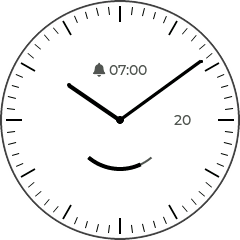

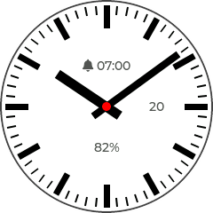
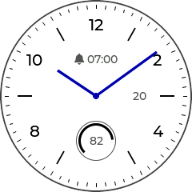
</p>
<p>
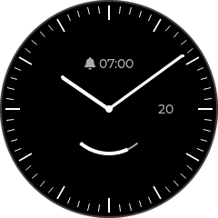
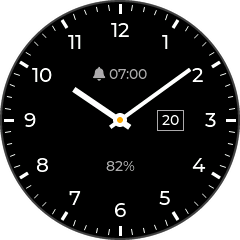
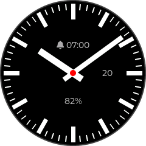
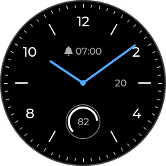
</p>
<p>


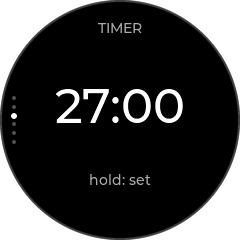

</p>
<p>
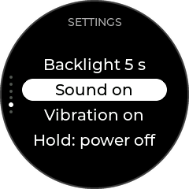
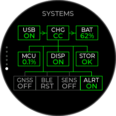
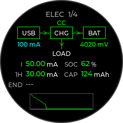
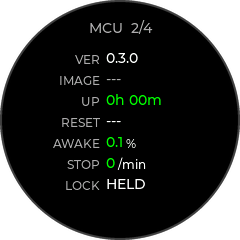
</p>

Screenshots of the Zephyr firmware from its simulator, taken with `una-z -s
shot --round`, which cuts the square image to the watch's round screen; the
watch draws the same screens.

- `refs/` — upstream clones, not tracked: `una-sdk`, `una-kernel-public`, `una-hardware`
- `docs/` — datasheets and hardware notes, see [docs/README.md](docs/README.md)
- `scripts/` — `una-install`, `una-build-kernel`, `una-pack`, `una-z` (on `PATH` inside the dev shell)
- `zephyr/` — west workspace for the Zephyr firmware; only `zephyr/una/` is tracked
- `apps/` — your own apps
- `build/` — out-of-tree build output, not tracked

Upstream documentation is in `refs/una-sdk/Docs/`; start with `sdk-setup.md`,
`platform-overview.md` and `Tutorials/HelloWorld/ARCHITECTURE.md`.

## Environment

`direnv allow` once; the flake provides Arm GNU Toolchain 14.3.rel1, CMake, Ninja,
Python with the packer dependencies, SDL2 for the simulator, Node.js for the LVGL
font converter, plus openocd, probe-rs, tio and clangd. `UNA_SDK` points at
`refs/una-sdk`.

## Build an app

```sh
cmake -G Ninja -S refs/una-sdk/Docs/Tutorials/HelloWorld/Software/Apps/HelloWorldLVGL-CMake -B build/hello
cmake --build build/hello        # -> build/hello/HelloWorldLVGL_<version>.uapp
```

`apps/hello` is a working copy of that tutorial with its own name and ID:

```sh
cmake -G Ninja -S apps/hello/Software/Apps/Hello-CMake -B build/hello
cmake --build build/hello        # also copied to apps/hello/Output/
cmake -G Ninja -S apps/hello/Software/Apps/LVGL-GUI/simulator -B build/hello-sim
cmake --build build/hello-sim    # -> apps/hello/Software/Apps/LVGL-GUI/simulator/build/bin/HelloSimulator
```

To start another app, copy an LVGL tutorial (`refs/una-sdk/Docs/Tutorials/*`, the
`LVGL-GUI` and `*LVGL-CMake` folders plus `Libs`) into `apps/` and change
`APP_NAME` and `APP_ID` in its `CMakeLists.txt`.

## Simulator

```sh
cmake -G Ninja -S refs/una-sdk/Docs/Tutorials/HelloWorld/Software/Apps/LVGL-GUI/simulator -B build/hello-sim
cmake --build build/hello-sim
```

The binary is written to `bin/` inside the build directory. Keys 1-4 are the
buttons L1, L2, R1, R2; Esc quits.

## Install on the watch

Connect USB and wait for the `UNA WATCH` drive, then:

```sh
una-install build/hello/HelloWorldLVGL_*.uapp   # copies to Apps/HelloWorldLVGL/
una-install -l                                  # list what is installed
```

The app list is only rebuilt at boot. `una-install -r FILE.uapp` reboots the watch
over its serial console after copying (`una-cli reset` does only the reboot).

On kernel 1.7.0 the drive does not come back after such a reboot until the cable
is replugged, so each new build still needs one replug. Upstream PR
[una-kernel-public#15](https://github.com/UNAWatch/una-kernel-public/pull/15)
adds a `usb drive on` console command that removes that.

## Console and logs

`una-cli menu` lists the console commands; `tio /dev/una-watch` opens it
interactively (commands must end in LF, prompt `una>`). Stay off the port for
about 10 seconds after the watch starts: typing in that window enters factory
test mode (`una-test>`); closing the port restarts the watch normally.

The debug UART (USART3 TX, 921600 baud) needs a USB-C debug adapter, see
[docs/README.md](docs/README.md).

## Kernel

`kernel/` is a working clone of the kernel repo (not tracked here), on branch
`custom`. `refs/una-kernel-public` stays pristine.

```sh
una-build-kernel        # Docker, image xanderhendriks/stm32cubeide:16.0, ~4 min
```

Output goes to `kernel/Exe/`. Images worth keeping are in `firmware/` with a
`SHA256SUMS` file:

- `firmware/official-v1.7.0/` — UNA's release, the restore image. A local build
  of tag `v1.7.0` is bit-identical to it.
- `firmware/custom-<version>/` — own builds.

### Install a kernel (same steps for custom and for restoring the official one)

1. Charge the watch; the bootloader refuses to update on low battery.
2. Turn the watch off, then hold the power button for 4 seconds as it turns on,
   until the bootloader menu appears.
3. Connect USB. The watch shows "USB connected" and a drive appears.
4. First time only: run `una-backup` to save what is on that drive, including the
   factory-reset image (`.gld`) the watch shipped with.
5. Copy the `.ota` to the root of the drive. Leave the `.gld` alone unless you
   want to change what a factory reset restores.
6. Eject, unplug, and choose **Continue** in the bootloader menu. On bootloader
   0.1.4 this starts the old firmware once more; the update is installed at
   the next reset (hold power ~20 s). It then stays at 100 % until one more
   reset.

To go back to stock, do the same with
`firmware/official-v1.7.0/UnaWatch-Kernel_1.7.0.ota`. The bootloader accepts any
version, including older ones.

## Zephyr

`zephyr/una/` holds the west manifest, the `una_watch` board, the display
driver and the app. What it does so far:

- Five watch faces: a digital one and four analogue dials, white or black
  (below). Each shows the date, the battery and the alarm time.
- One ring of pages, no menu: face, stopwatch, countdown timer, one daily
  alarm, settings (backlight time, sound, vibration, power off) and systems.
  Timer and alarm ring with the buzzer and the vibration motor.
- System pages in the manner of an aircraft's: an overview of the subsystems
  on the power lines, and a page each for the electrical system (currents,
  charge, an hour's trend), the MCU, storage and alerts.
- Battery gauge and charger status, power-off, Stop mode whenever idle and off
  USB: about 0.85 mA idle, a week on a charge (measured at v0.1.0).
- Clock from the RTC with a stored UTC offset, set from the computer.
- Log files on the eMMC with a telemetry line a minute.
- Firmware update over USB with automatic rollback; a simulator.
- Not yet: Bluetooth (the radio chip is held in reset), sensors, GPS. The plan
  is [docs/zephyr-plan.md](docs/zephyr-plan.md).

The version is in `zephyr/una/app/VERSION` and shown on the MCU system page.

The stock bootloader stays in place and starts MCUboot at 0x08060000, which
starts the app:

| Flash | Contents |
|---|---|
| 0x08000000, 384 KB | UNA bootloader and shared C library; never written |
| 0x08060000, 128 KB | MCUboot |
| 0x08080000, 1536 KB | slot 0, the running image |
| 0x08200000, 1536 KB | slot 1, where an upload lands |
| 0x08380000, 512 KB | settings (UTC offset, alarm, backlight time, ...) |

```sh
west init -l zephyr/una && (cd zephyr && west update --narrow -o=--depth=1)   # once
west build -b una_watch --sysbuild -d build/zephyr zephyr/una/app
```

### Day to day, cable in, no buttons

```sh
west build -d build/zephyr && una-z flash   # ~30 s: upload, test boot, confirm
una-z sh kernel uptime                      # any shell command
una-z shot                                  # screenshot -> build/shot.png
una-z shot --round face.png                 # cut to the round screen, for showing
una-z press 3                               # press SW3 (SW1-SW4, see the board dts)
una-z press 4 1000                          # hold SW4 for a second
una-z log 10                                # watch log messages for 10 s
una-z logs                                  # copy the log files off the eMMC -> logs/
una-z time                                  # set the watch's clock from this computer
una-z reset                                 # reboot through mcumgr
```

`una-z flash` boots the new image once as a test and confirms it when its shell
answers. An image that crashes, hangs (8 s watchdog) or is never confirmed is
swapped back for the previous one at the next reset.

The watch is two USB serial ports, `2fe3:0004` "UNA Watch Zephyr": interface 0
is the shell, interface 2 is mcumgr. `/dev/una-watch` does not point at either.

If `una-z flash` is interrupted before it has confirmed, the new image keeps
running unconfirmed and the next upload fails. `una-z sh mcuboot` shows that
state (`confirmed: 0`); `una-z sh mcuboot confirm` keeps the image, a reset
puts the previous one back.

### Simulator

The same app builds as a Linux program (Zephyr's `native_sim`): the UI, the
shell, settings, the clock, alarms and timers run as on the watch, with the
screen in SDL. What is hardware on the watch (battery, buzzer, motor) is
stood in for by `src/sim.c` and set or read with the `sim` shell command.
Power, USB, storage and Bluetooth are not in it.

```sh
west build -b native_sim/native/64 -d build/sim zephyr/una/app   # once; then west build -d build/sim
una-z sim                    # start it (again), no window; sets its clock
una-z sim --window           # the same with the screen in a window
una-z -s shot                # as on the watch -> build/sim-shot.png
una-z -s press 2
una-z -s sh sim battery 15 0 # 15 %, no USB power
una-z -s sh sim state        # buzzer, motor, power-off asked for
una-z sim stop
```

`prj.conf` is what both builds share; `boards/una_watch.conf` and
`boards/native_sim_native_64.conf` are added for each. Settings are kept in
`build/sim/flash.bin`.

### Buttons and screens

The pages lie in a ring and the buttons mean the same on all of them:

| Button | Stock name | Does, everywhere |
|---|---|---|
| SW1, top left | UP | previous of what is beside this: page, row, value |
| SW3, bottom left | DOWN | next |
| SW2, top right (power) | SELECT | what the page does, or go in; held: go in to change it |
| SW4, bottom right | BACK | out one level, then to the face; held: the face |

DOWN from the face goes through the ring in this order, UP the other way:

| Page | SELECT | SELECT held |
|---|---|---|
| Face | go in: choose the face | the same |
| Stopwatch | start, stop | reset |
| Timer | start, stop | go in: set the minutes |
| Alarm | on, off | go in: set hour, then minute |
| Settings | go in: the list; then change the row | on "power off": power off |
| Systems | go in: a page per subsystem | the same |

Inside, UP and DOWN change the value or move to the next row or page, and
what can be changed is cyan. There are no questions to confirm: what would
need one is asked for by holding instead. A press is acted on at release;
"held" is 0.7 s. Timer and alarm ring with the buzzer and the motor (`alert
ring` in the shell does the same) until any button is pressed. `una-z sh ui`
shows the current page, `una-z sh ui page timer` goes to one.

The system pages use one set of colours: white for names and units, green
for a live value that is normal and for a line that carries current, amber
and red for what needs attention, cyan for what can be set, grey for what is
off or not known. They are drawn in `src/systems.c` with the helpers of
`src/draw.c`.

### Watch faces

SELECT on the face opens a chooser that shows each face; UP and DOWN go
through them and SELECT turns an analogue dial white or black. From the shell:
`una-z sh face 3 1` (face 0-4, white 0 or 1).

| Face | After | Battery shown as |
|---|---|---|
| Digital | | percentage, coloured by level |
| Bill | Max Bill's dials for Junghans: lines only | an arc under the centre |
| Rams | Braun's watches: numerals, batons, a yellow dot | a number; date in a window |
| Station | the railway station clock: heavy bars, block hands | a number |
| Tangente | Nomos: numerals and batons in turn, blue hands | a gauge where the original has its seconds |

The dials are drawn in `src/dial.c`, one function each, from a few helpers
(ticks, numerals, hands, arc, text). There is no second hand, so a dial is
redrawn once a minute. Colours are limited to the panel's four levels per
channel.

A screen is a `struct ui_screen` (`src/ui.h`): `enter` builds its widgets,
`update` refreshes them and says when it is next due, `key` gets the buttons.
The main thread sleeps between those, so an idle screen costs nothing.

### Telemetry

The watch writes its ordinary Zephyr log to the eMMC with the standard
file-system log backend: `/USER:/Log/Zephyr/log.NNNN`, 32 files of 1 MB, oldest
overwritten. `/USER:` is the stock firmware's user volume, so the same files
are under `Log/Zephyr/` when the stock firmware shows the drive over USB.

Once a minute the power thread logs one line:

```
power: tm 2026-11-20T10:59:21Z usb=1 soc=99 mv=4400 ua=-1041 chg=6 stops=0 awake=0/1000 keys=0 backlight_ms=0
```

`ua` is the mean battery current over the minute (negative = discharging; the
gauge is only good to a few mA), `stops` the number of Stop-mode entries,
`awake` the share of the minute the CPU was not idle, `keys` and
`backlight_ms` button presses and backlight time. USB power changes are logged
as they happen.

Wear: a line is about 120 bytes, so about 170 KB a day, and each line costs
one sync of a few 4 KB blocks. Even at 1 MB of flash writes per sync that is
1.4 GB a day against roughly 12 TB of endurance (4 GB at 3000 cycles): decades.

### When the app does not come up

- **MCUboot recovery:** hold SW1 (top-left) through a reset. The screen keeps
  the UNA logo and the watch enumerates as "UNA Watch MCUboot". Then
  `smpmgr --port /dev/serial/by-id/usb-UNA_UNA_Watch_MCUboot_*-if00 image upload build/zephyr/app/zephyr/zephyr.signed.bin`
  followed by `... os reset`. This writes slot 0 directly.
- **Reset without a working app:** hold the power button (top-right) for about
  20 s; the PMIC power-cycles the watch. Keep holding for the UNA bootloader
  menu, release for a normal start.
- **First install, or MCUboot itself is broken:** pack MCUboot and the app into
  one `.ota` and install it like a kernel (above). `firmware/zephyr-<version>/`
  keeps one that is known to work.

```sh
una-pack build/zephyr/mcuboot/zephyr/zephyr.bin \
         --at 0x20000 build/zephyr/app/zephyr/zephyr.signed.bin \
         -o build/zephyr/una-zephyr.ota
```

### What protects the restore path

- An `.ota` holds only the kernel (flash from 0x08060000). The bootloader and the
  shared C library in the first 384 KB are not written by an update.
- The bootloader runs before the kernel and its menu is reached with the power
  button, so a kernel that does not boot can still be replaced.
- Not covered: a kernel that erases the bootloader itself, or a watch that
  cannot be powered off. The only fix then is the `.hex` (whole flash) over SWD,
  which needs a USB-C debug adapter that we do not have (see docs/README.md).
